
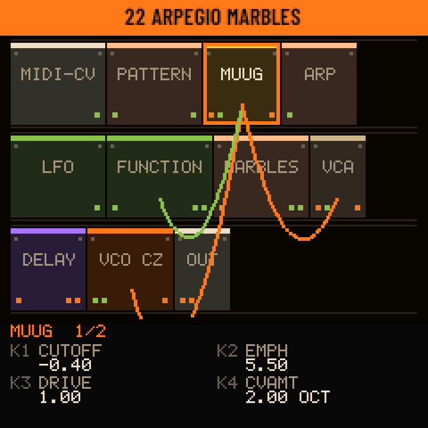

<h1 align="center">Kitten Rack</h1>

<b>Un sintetizador modular adentro del M-VAVE FM-1.</b> 
56 módulos estilo Eurorack que se cablean en el mismo FM-1, un secuenciador que graba lo que tocás, visuales, MIDI LEARN y audio por USB. 
Por <a href="https://github.com/BlackKittenDevices">Black Kitten Devices</a> · firmware libre · GPL-3.0

<a href="https://blackkittendevices.github.io/kitten-rack/play.html"><b>▶ Tocalo en el navegador</b></a> ·
<a href="https://blackkittendevices.github.io/kitten-rack/"><b>Editor web</b></a> ·
<a href="https://github.com/BlackKittenDevices/kitten-rack/releases/latest"><b>Descargar</b></a> ·
<a href="docs/MANUAL.es.md">Manual completo</a> ·
<a href="README.md">English</a>

---

## Qué es

Kitten Rack convierte el FM-1 en un **Eurorack en tus manos**. Un patch es un rack entero: módulos con sus perillas, jacks y cables, donde cualquier salida va a cualquier entrada. Lo armás, lo tocás, lo secuenciás y lo guardás, en el FM-1 o en el editor web, y los dos suenan exactamente igual.

- **56 módulos:** VCOs (clásico, wavetable, phase distortion), un ladder estilo Minimoog que autooscila, un low pass gate estilo Buchla, un secuenciador estilo Moog 960 que toca tus voces, Turing, Marbles, Euclídeo, caos de Lorenz, funciones estilo Maths, eco de cinta, reverb de resorte, granular y más.
- **Cableado en el equipo:** agregás y sacás módulos y cables en el mismo FM-1 (EDIT), y ves el rack entero con sus cables (GLO).
- **Un secuenciador que graba lo que tocás:** hasta 64 patrones de 64 pasos por patch, piano roll, grilla de batería y canciones. Las tomas en vivo guardan tu tiempo (o caen en la grilla), con click que nunca llega a tu DAW, cuenta previa, tomas libres donde el tempo te sigue, deshacer y tap tempo.
- **33 patches de fábrica** propios: teclados de los 60, máquinas generativas que tocan solas, drones y ruido.
- **Visuales** en el FM-1 (osciloscopio y cinco escenas animadas que siguen la música) y a pantalla completa en la compu o un proyector.
- **MIDI LEARN:** asignás las perillas de tu controlador en el editor web; el mapa queda guardado en el patch y funciona en el FM-1 sin compu, por USB o TRS.
- **Audio y MIDI por USB:** el FM-1 es una placa de sonido (grabalo en cualquier DAW, sin driver) y un dispositivo MIDI.
- Pantallas en **español o inglés**. Naranja sobre negro.

## Pantallas

**El rack y el cableado en el FM-1**

| | | |
| :---: | :---: | :---: |
|  El rack (GLO): todos los módulos y cables | 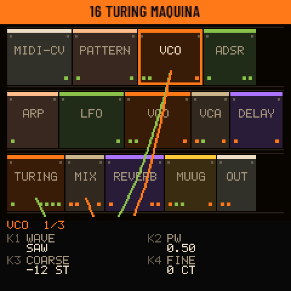 Otro patch: máquina de Turing | 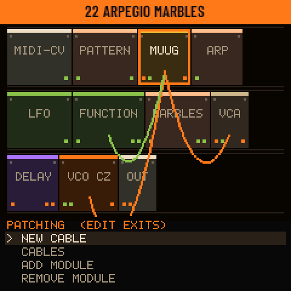 Cableado (EDIT): cables y módulos |
| 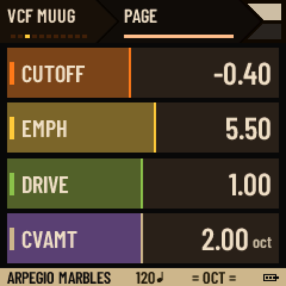 La página de un módulo: K1–K4 | 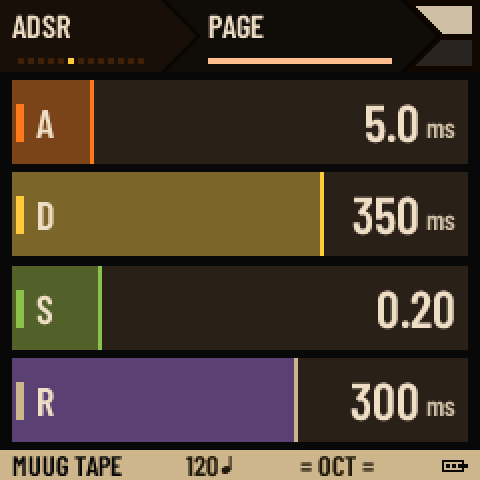 Una envolvente (ENV) | 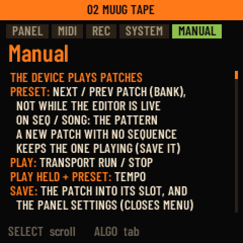 El manual, adentro del FM-1 |

**El secuenciador**

| | | |
| :---: | :---: | :---: |
| 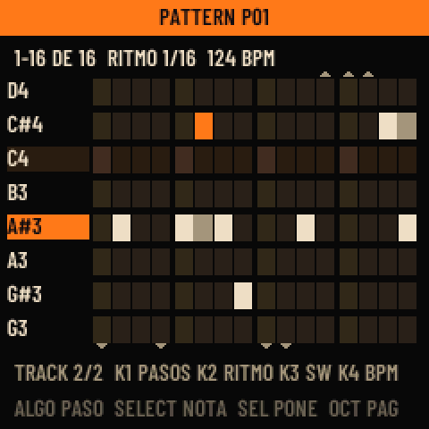 Piano roll | 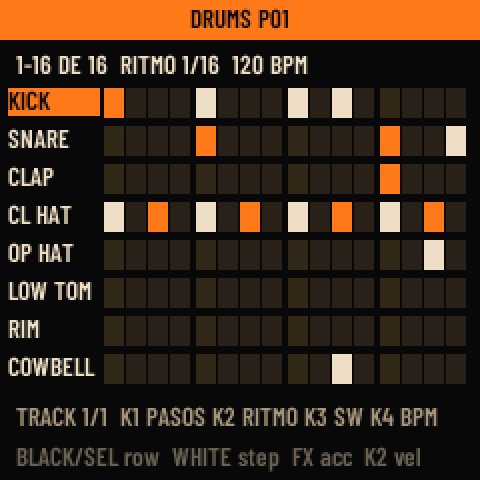 Grilla de batería | 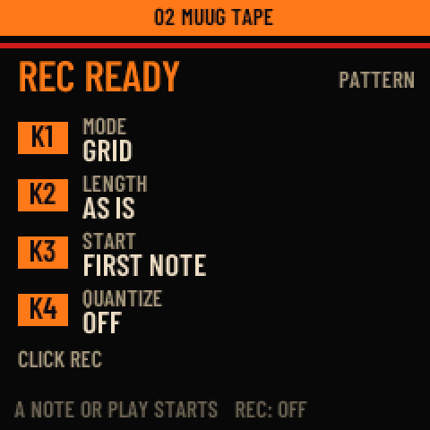 La ventana de REC: cómo es la toma |
| 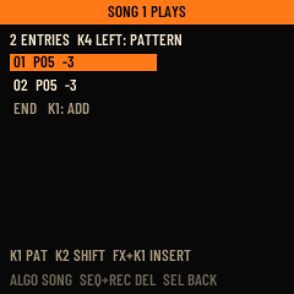 Canciones | 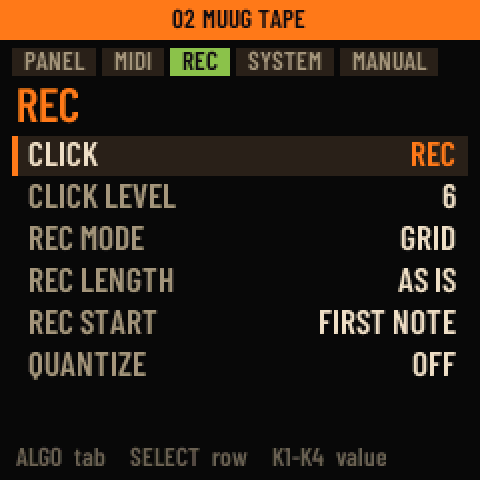 MENÚ > REC: click y tomas | |

**Las visuales** (HOME en la página del módulo)

| | | |
| :---: | :---: | :---: |
| 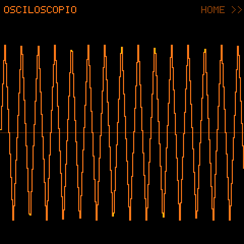 Osciloscopio | 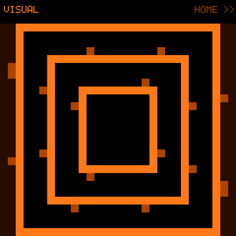 Pasillo | 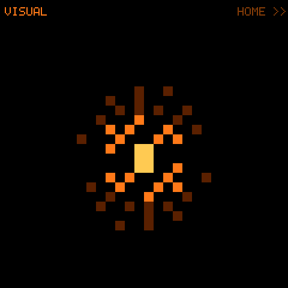 Estallido |
| 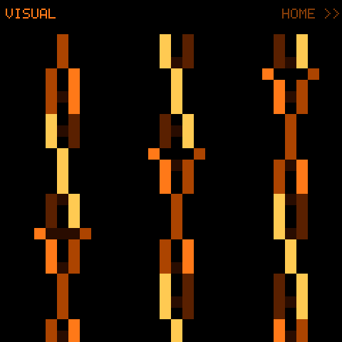 Hélices | 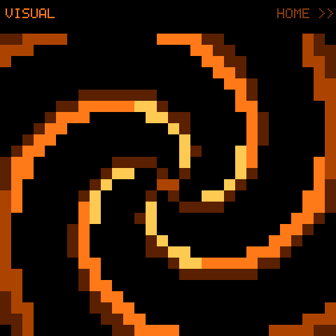 Espiral | 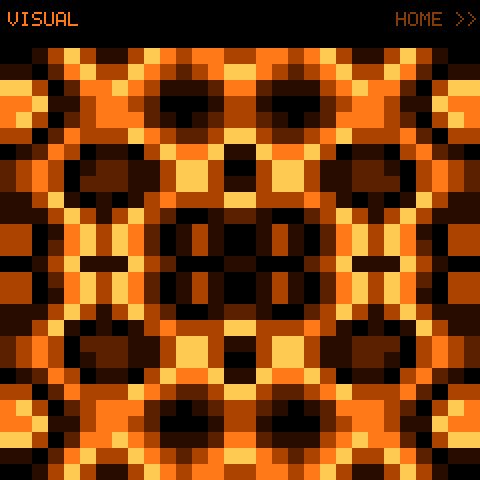 Plasma |

**En la compu**

| El editor web (en vivo con el FM-1, MIDI LEARN) | El FM-1 en el navegador |
| :---: | :---: |
| 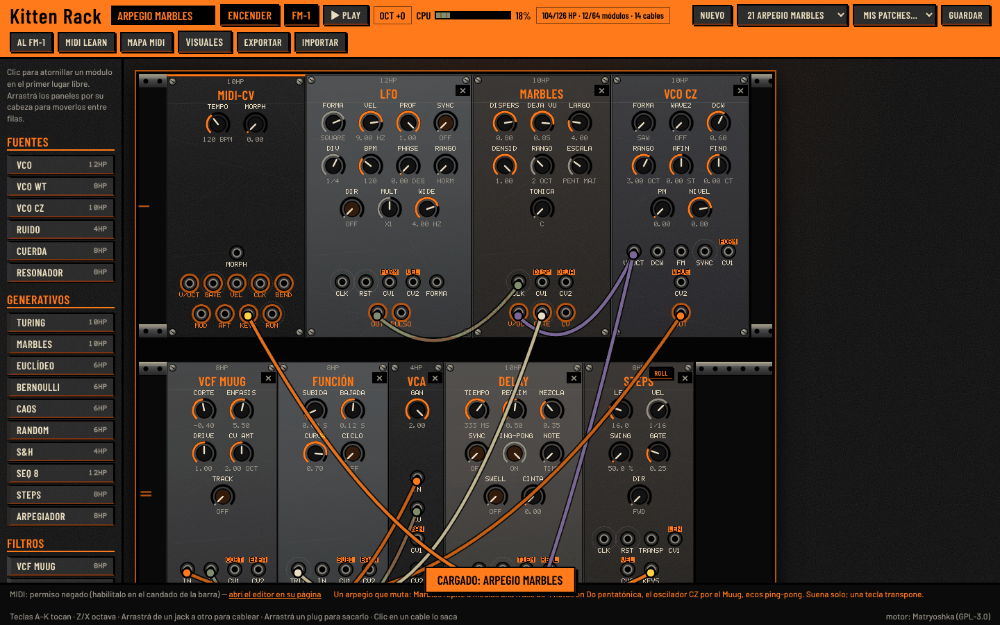 | 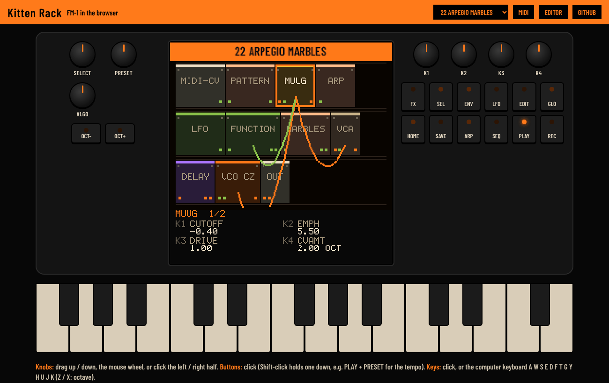 |

## Guía rápida

**Un patch es un rack.** PRESET elige el patch. La pantalla muestra un módulo a la vez: **SELECT** el módulo, **ALGO** su página, **K1–K4** sus cuatro perillas. Las teclas lo tocan (con velocidad), OCT− / OCT+ cambian la octava.

| Botón | Qué hace |
| --- | --- |
| **GLO** | El rack: cada módulo como un panel, con sus cables. Otra vez: los ajustes del FM-1 (MIDI, reloj, idioma) |
| **EDIT** | Cableado en el equipo: cable nuevo, lista de cables, agregar módulo, quitar módulo |
| **FX / LFO / ENV** | Saltan entre los efectos / las fuentes y moduladores / las envolventes y filtros |
| **ARP** | Prende o apaga el arpegiador |
| **SEQ** | El secuenciador: piano roll o grilla, PRESET elige el patrón, SEL sostenido: canciones |
| **REC** | Grabar. Parado, abre la ventana de REC (MODO grilla o libre, LARGO, INICIO con una nota o tras una cuenta, CUANTIZAR). Sostenido 4 s: borra el patrón. REC + OCT−: deshacer |
| **PLAY** | Arranca / para. Sostenido + PRESET: tempo. Sostenido + toques de REC: tap tempo |
| **SAVE** | Guarda en uno de 64 lugares, o carga uno |
| **HOME** | Vuelve. En la página del módulo: las visuales. Sostenido: el menú y el manual |

Un botón queda encendido mientras se ve lo que abrió, y las teclas se encienden mientras suenan (MENÚ > PANEL > KEY LIGHTS).

**Los módulos**

| Familia | Módulos |
| --- | --- |
| Fuentes | VCO, VCO WT (wavetable), VCO CZ (phase distortion), Ruido, Cuerda (Karplus), Resonador (modal) |
| Generativos | Turing, Marbles, Euclídeo, Bernoulli, Caos (Lorenz), Random, S&H, Seq 8, Seq 960 (estilo Moog 960: 3 x 8 pasos, salida keys), Steps (el secuenciador), Arpegiador |
| Filtros | VCF Muug (ladder Minimoog), LPG (estilo Buchla), VCF Ladder, VCF Multi, Formante, Comb, Wavefolder |
| VCA y mezcla | VCA, Ring mod, Mix 4, Xfade, Pan, Selector, Compresor |
| Moduladores | Función (estilo Maths), ADSR, Env L/R, Env 8, Env DX, LFO, Slew, Pulso, Macro |
| Lógica y utilidades | Reloj/Div, Cuantizador, Mate, Lógica, Offset, Atenuversor, Ratio, Drum map, Scope |
| Efectos | Delay (con modo CINTA), Reverb (con modo RESORTE), Chorus, Phaser, Bitcrush, Granular, Freq shift |

Todo patch tiene **MIDI-CV** (teclado y MIDI) y **OUT**. Por patch: un delay, una reverb y un chorus; el editor muestra el CPU del FM-1 para el patch.

**El banco de fábrica:** INIT, MUUG TAPE, MUUG BAJO, LEAD 1969, BRONCES 1971, THEREMIN, CAMPANAS RING, BUCHLA TIMBRE, FM CHOWNING, VOCES FORMANTE, SYNC LEAD · BONK WEST COAST, COMPUTADORA S&H, BERLIN SEQ, PERCUSION MOD, TURING MAQUINA, EUCLIDES, MARBLES PLUCK, CAOS MELODICO, GOTAS RESONADOR, CUERDAS AZAR, ARPEGIO MARBLES, POLIRRITMO, ENJAMBRE LFO · LORENZ DRONE, DRONE MUUG, NIEBLA GRANULAR, SHIFT ESPACIAL, MAREA DE RUIDO, MAQUINA RUIDO, FEEDBACK COMB, BITCRUSH RADIO, CUERDA INFINITA.

Todo lo demás (el secuenciador paso a paso, la grabación, MIDI, MIDI LEARN, las visuales en pantalla grande, grabar en una DAW) está en el **[manual completo](docs/MANUAL.es.md)**, y uno corto vive adentro del FM-1 (HOME sostenido).

## Instalar

1. En [Releases](https://github.com/BlackKittenDevices/kitten-rack/releases/latest) bajá `KittenRack-instalador-X.Y.Z.zip` y descomprimilo.
2. Hace falta **Python 3.8 o más nuevo** (python.org o la Microsoft Store). Windows, macOS o Linux.
3. **Respaldá** lo que tenés en el FM-1 con el editor del firmware que usás ahora.
4. Enchufá el FM-1 con un cable USB **de datos**, cerrá todo programa que use MIDI y hacé doble clic en **`KittenRack.pyw`** → **INSTALAR Kitten Rack**. Uno o dos minutos; no desenchufes hasta que diga "Listo".

En el primer arranque Kitten Rack escribe sus 33 patches de fábrica. Para volver a otro firmware, la misma ventana tiene **OTRO FIRMWARE...** (cualquier `.fwsc`, por ejemplo Kitten Synths). Si algo sale mal, prendé el FM-1 con **OCT− + OCT+** apretados: queda esperando un firmware. Paso a paso en el [manual](docs/MANUAL.es.md#1-instalar-y-volver-atrás).

> Kitten Rack conserva la actualización por USB de Felucca, así que siempre podés instalar otro firmware. Instalar firmware alternativo es bajo tu propio riesgo.

## Créditos y licencia

Kitten Rack parte de [Matryoshka](https://github.com/glvno/matryoshka) de michael glaviano (1.5.1), que viene de [Modular-1](https://github.com/WiggisModular/Modular-1) de WiggisModular, y usa la capa de hardware y el cargador de actualizaciones de [Felucca](https://github.com/hugelton/Felucca) de Leo Kuroshita / Hügelton Instruments. El VCF Muug viene de [FMini-1](https://github.com/ruppert/fmini-1) de Guilherme Ruppert.

Todo el código es **GPL-3.0-only**: ver [LICENSE](LICENSE) y [LICENSING.md](LICENSING.md) (las partes de terceros en [LICENSES/](LICENSES)). Cambios por versión: [CHANGELOG.md](CHANGELOG.md). Para desarrolladores: el [último capítulo del manual](docs/MANUAL.es.md#12-para-desarrolladores) y [docs/ARCHITECTURE.md](docs/ARCHITECTURE.md).

Black Kitten Devices · =^.^=

