
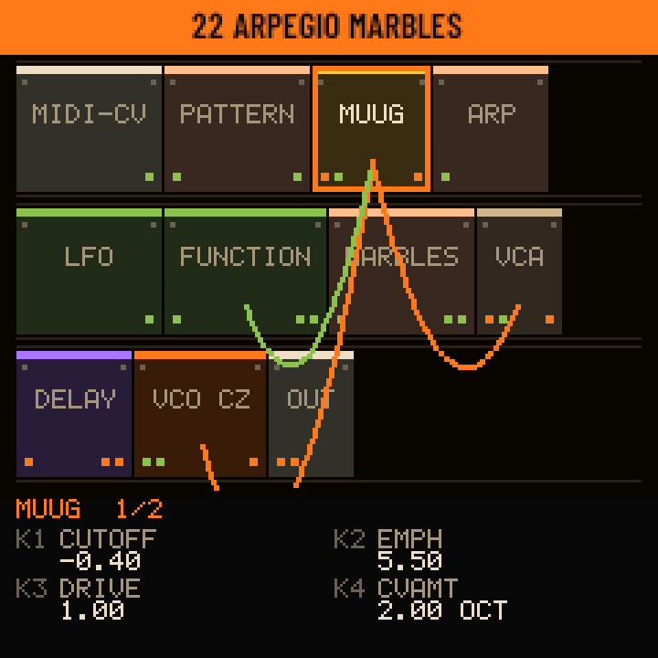

<h1 align="center">Kitten Rack</h1>

<b>A modular synthesizer inside the M-VAVE FM-1.</b> 
Over 50 Eurorack-style modules patched with cables on the FM-1 itself, a sequencer that records what you play, visuals, MIDI LEARN and USB audio. 
By <a href="https://github.com/BlackKittenDevices">Black Kitten Devices</a> · free firmware · GPL-3.0

<a href="https://blackkittendevices.github.io/kitten-rack/play.html"><b>▶ Play it in the browser</b></a> ·
<a href="https://blackkittendevices.github.io/kitten-rack/"><b>Web editor</b></a> ·
<a href="https://github.com/BlackKittenDevices/kitten-rack/releases/latest"><b>Download</b></a> ·
<a href="docs/MANUAL.md">Full manual</a> ·
<a href="README.es.md">Español</a>

---

## What it is

Kitten Rack turns the FM-1 into a **Eurorack in your hands**. A patch is a whole rack: modules with their knobs, jacks and cables, where any output can go to any input. You build it, play it, sequence it and save it, on the FM-1 or in the web editor, and both sound exactly the same.

- **Over 50 modules:** VCOs (classic, wavetable, phase distortion), a self-oscillating Minimoog-style ladder, a Buchla-style low pass gate, Turing, Marbles, Euclidean, Lorenz chaos, Maths-style functions, a tape echo, a spring reverb, granular, and more.
- **Patch on the device:** add and remove modules and cables right on the FM-1 (EDIT), and see the whole rack with its cables (GLO).
- **A sequencer that records what you play:** up to 64 patterns of 64 steps per patch, a piano roll, a drum grid and songs. Live takes keep your timing (or snap to the grid), with a click that never reaches your DAW, a count-in, free takes where the tempo follows you, undo and tap tempo.
- **33 factory patches** of our own: 60s keys, generative machines that play by themselves, drones and noise.
- **Visuals** on the FM-1 (oscilloscope and five animated scenes that follow the music) and full screen on a computer or projector.
- **MIDI LEARN:** map your controller's knobs in the web editor; the map is stored in the patch and works on the FM-1 with no computer, over USB or TRS.
- **USB audio and MIDI:** the FM-1 is a sound card (record it in any DAW, no driver) and a MIDI device.
- **English or Spanish** screens.
## Screens

**The rack and patching on the FM-1**

| | | |
| :---: | :---: | :---: |
|  The rack (GLO): every module and cable | 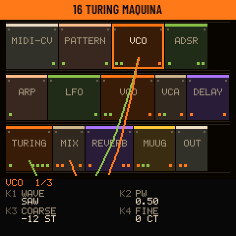 Another patch: Turing machine | 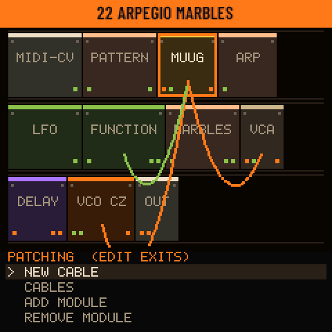 Patching (EDIT): cables and modules |
| 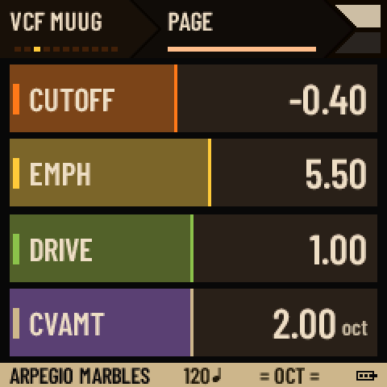 A module's page: K1–K4 | 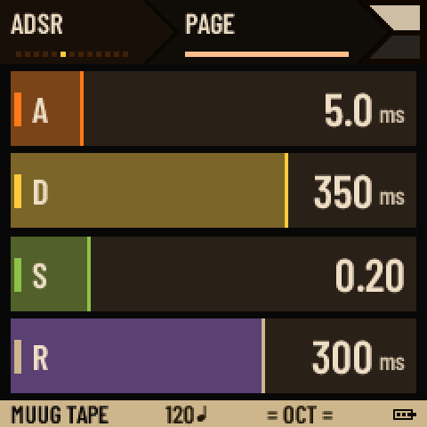 An envelope (ENV) | 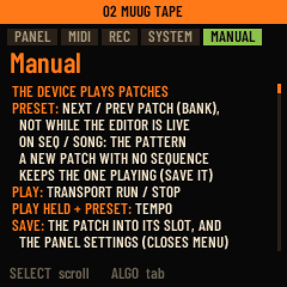 The manual, inside the FM-1 |

**The sequencer**

| | | |
| :---: | :---: | :---: |
| 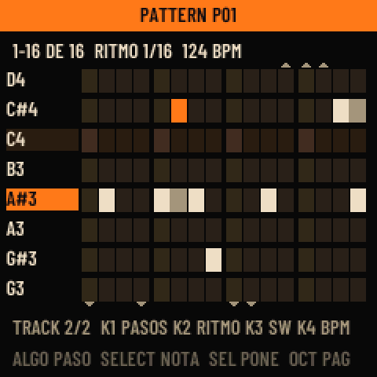 Piano roll | 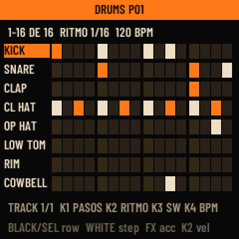 Drum grid | 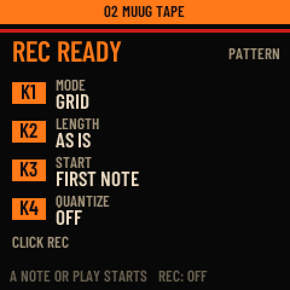 The REC window: how the take goes |
| 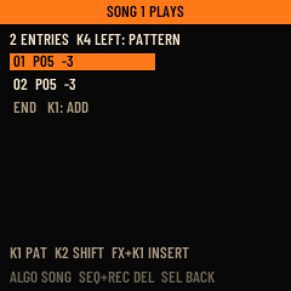 Songs | 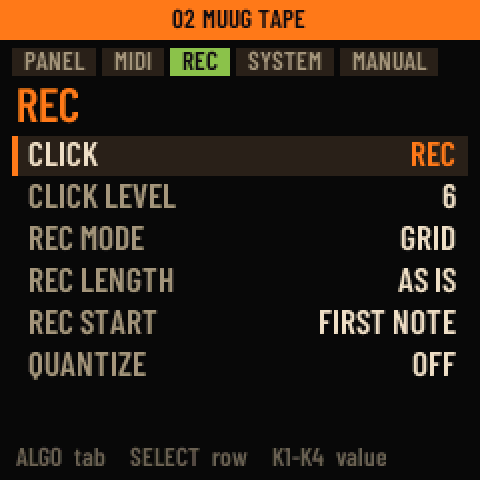 MENU > REC: click and takes | |

**The visuals** (HOME on the module page)

| | | |
| :---: | :---: | :---: |
| 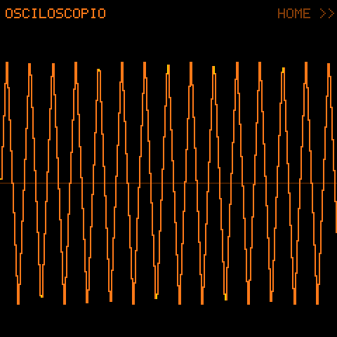 Oscilloscope | 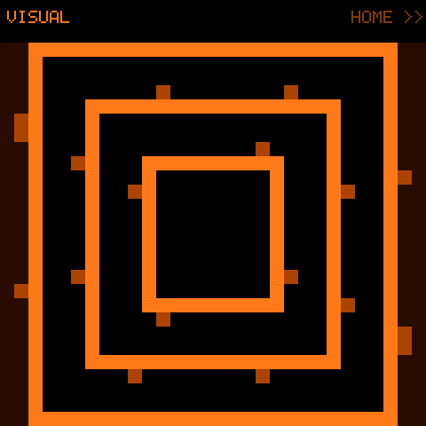 Corridor | 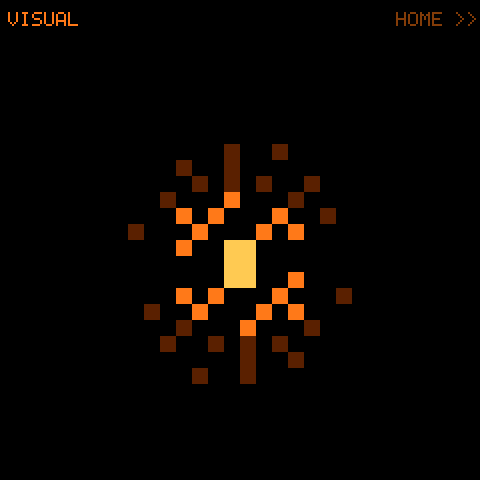 Starburst |
| 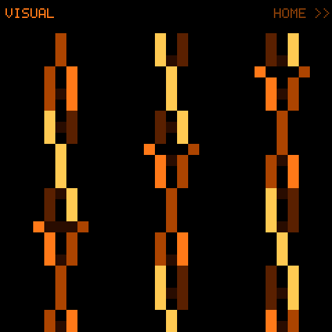 Helices | 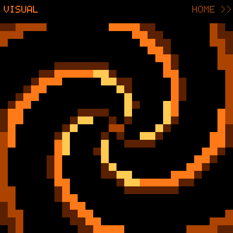 Spiral | 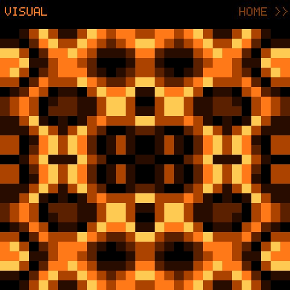 Plasma |

**On the computer**

| The web editor (live with the FM-1, MIDI LEARN) | The FM-1 in the browser |
| :---: | :---: |
| 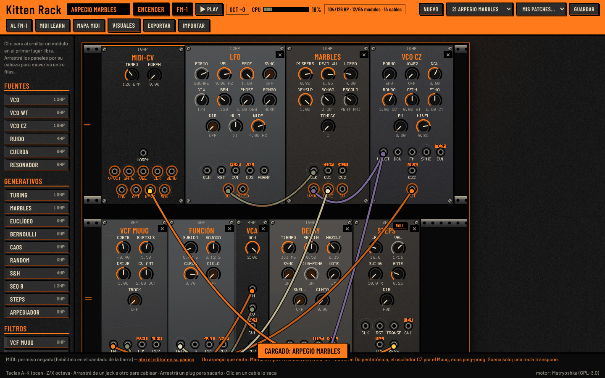 | 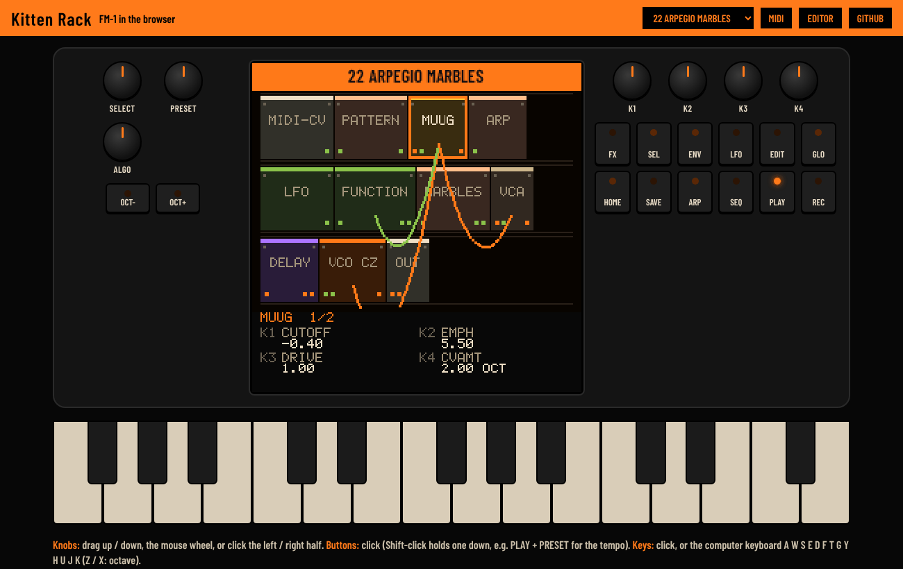 |

## Quick guide

**A patch is a rack.** PRESET picks the patch. The screen shows one module at a time: **SELECT** the module, **ALGO** its page, **K1–K4** its four knobs. The keys play it (with velocity), OCT− / OCT+ change the octave.

| Button | What it does |
| --- | --- |
| **GLO** | The rack: every module as a panel, with its cables. Again: the FM-1's settings (MIDI, clock, language) |
| **EDIT** | Patching on the device: new cable, cable list, add module, remove module |
| **FX / LFO / ENV** | Jump between the effects / the sources and modulators / the envelopes and filters |
| **ARP** | The arpeggiator on or off |
| **SEQ** | The sequencer: piano roll or drum grid, PRESET picks the pattern, SEL held: songs |
| **REC** | Record. Stopped, it opens the REC window (MODE grid or free, LENGTH, START on a note or after a count-in, QUANTIZE). Held 4 s: clear the pattern. REC + OCT−: undo |
| **PLAY** | Start / stop. Held + PRESET: tempo. Held + taps on REC: tap tempo |
| **SAVE** | Save into one of 64 slots, or load one |
| **HOME** | Back. On the module page: the visuals. Held: the menu and the manual |

A button stays lit while what it opened shows, and the keys light while they sound (MENU > PANEL > KEY LIGHTS).

**The modules**

| Family | Modules |
| --- | --- |
| Sources | VCO, VCO WT (wavetable), VCO CZ (phase distortion), Noise, String (Karplus), Resonator (modal) |
| Generative | Turing, Marbles, Euclidean, Bernoulli, Chaos (Lorenz), Random, S&H, Seq 8, Steps (the sequencer), Arpeggiator |
| Filters | VCF Muug (Minimoog ladder), LPG (Buchla style), VCF Ladder, VCF Multi, Formant, Comb, Wavefolder |
| VCA and mix | VCA, Ring mod, Mix 4, Xfade, Pan, Selector, Compressor |
| Modulators | Function (Maths style), ADSR, Env L/R, Env 8, Env DX, LFO, Slew, Pulse, Macro |
| Logic and utilities | Clock/Div, Quantizer, Math, Logic, Offset, Attenuverter, Ratio, Drum map, Scope |
| Effects | Delay (with TAPE mode), Reverb (with SPRING mode), Chorus, Phaser, Bitcrush, Granular, Freq shift |

Every patch has **MIDI-CV** (keyboard and MIDI in) and **OUT**. Per patch: one delay, one reverb and one chorus; the editor shows the FM-1's CPU for the patch.

**The factory bank:** INIT, MUUG TAPE, MUUG BAJO, LEAD 1969, BRONCES 1971, THEREMIN, CAMPANAS RING, BUCHLA TIMBRE, FM CHOWNING, VOCES FORMANTE, SYNC LEAD · BONK WEST COAST, COMPUTADORA S&H, BERLIN SEQ, PERCUSION MOD, TURING MAQUINA, EUCLIDES, MARBLES PLUCK, CAOS MELODICO, GOTAS RESONADOR, CUERDAS AZAR, ARPEGIO MARBLES, POLIRRITMO, ENJAMBRE LFO · LORENZ DRONE, DRONE MUUG, NIEBLA GRANULAR, SHIFT ESPACIAL, MAREA DE RUIDO, MAQUINA RUIDO, FEEDBACK COMB, BITCRUSH RADIO, CUERDA INFINITA.

Everything else (the sequencer step by step, recording, MIDI, MIDI LEARN, the visuals on a big screen, recording into a DAW) is in the **[full manual](docs/MANUAL.md)**, and a short one lives inside the FM-1 (hold HOME).

## Install

1. From [Releases](https://github.com/BlackKittenDevices/kitten-rack/releases/latest) download `KittenRack-instalador-X.Y.Z.zip` and unzip it.
2. You need **Python 3.8 or newer** (python.org or the Microsoft Store). Windows, macOS or Linux.
3. **Back up** what you have on the FM-1 with the editor of the firmware you use now.
4. Plug the FM-1 in with a USB **data** cable, close every program that uses MIDI, and double click **`KittenRack.pyw`** → **INSTALAR Kitten Rack**. One or two minutes; don't unplug until it says "Listo".

On the first boot Kitten Rack writes its 33 factory patches. To go back to another firmware, the same window has **OTRO FIRMWARE...** (any `.fwsc`, e.g. Kitten Synths). If something goes wrong, switch the FM-1 on holding **OCT− + OCT+**: it waits for a firmware. Step by step in the [manual](docs/MANUAL.md#1-installing-and-going-back).

> Kitten Rack keeps Felucca's USB update, so you can always install another firmware. Installing custom firmware is at your own risk.

## Credits and license

Kitten Rack starts from [Matryoshka](https://github.com/glvno/matryoshka) by michael glaviano (1.5.1), which comes from [Modular-1](https://github.com/WiggisModular/Modular-1) by WiggisModular, and uses the hardware layer and the update loader of [Felucca](https://github.com/hugelton/Felucca) by Leo Kuroshita / Hügelton Instruments. Inspered in the software VCV RACK. The VCF Muug comes from [FMini-1](https://github.com/ruppert/fmini-1) by Guilherme Ruppert.

All the code is **GPL-3.0-only**: see [LICENSE](LICENSE) and [LICENSING.md](LICENSING.md) (third-party parts in [LICENSES/](LICENSES)). Changes by version: [CHANGELOG.md](CHANGELOG.md). For developers: the [manual's last chapter](docs/MANUAL.md#12-for-developers) and [docs/ARCHITECTURE.md](docs/ARCHITECTURE.md).

Black Kitten Devices · =^.^=

